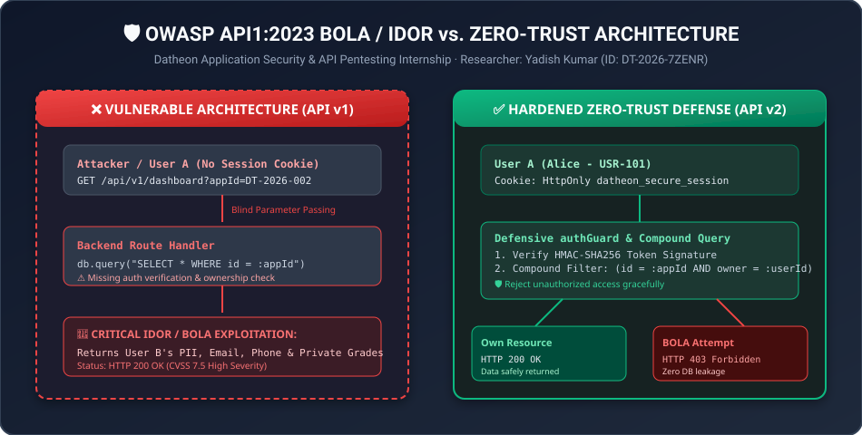
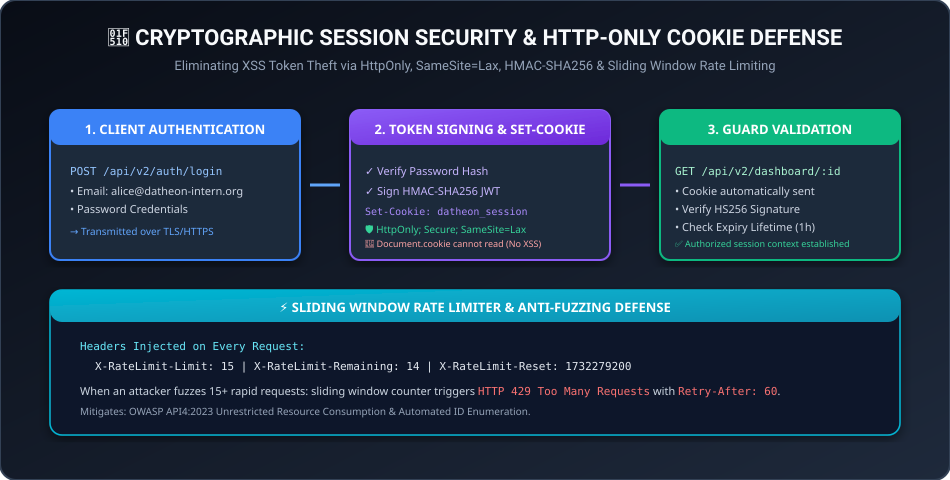
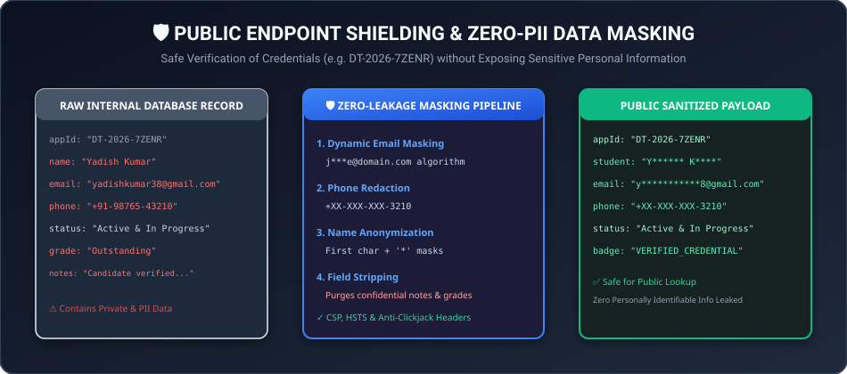
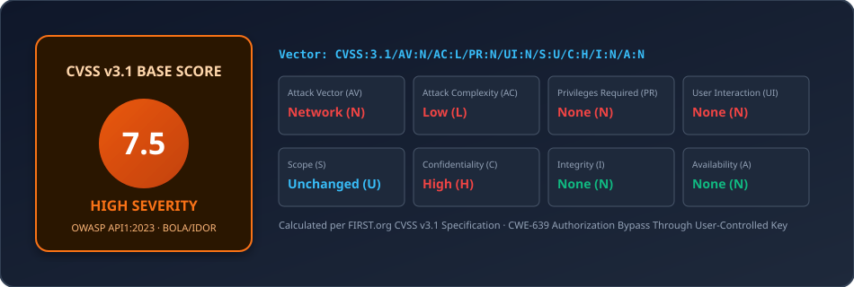

<div align="center">

# 🛡️ Datheon Application Security & API Pentesting Internship
### *Hunting & Remediating BOLA/IDOR Vulnerabilities, Cryptographic Session Defense & Zero-Trust API Architecture*

[](https://github.com/yadishkumar38-sketch/Datheon_AppSec_Internship)
[](ci/security-ci.yml)
[](https://owasp.org/API-Security/)
[](docs/VULNERABILITY_DISCLOSURE_REPORT.md)
[](LICENSE)
[](https://nodejs.org)

---

### **Student Profile & Internship Credentials**
| **Field** | **Credential Details** |
|:---|:---|
| **Student / Security Researcher** | **Yadish Kumar** ([@yadishkumar38-sketch](https://github.com/yadishkumar38-sketch)) |
| **Internship Program** | **Application Security & API Pentesting Internship (4-Week Cadence Track)** |
| **Datheon Application ID** | **`DT-2026-7ZENR`** |
| **Commencement Date** | November 20, 2026 |
| **Evaluation Cutoff / Deadline** | December 18, 2026 |
| **Submission Repository** | `Datheon_AppSec_Internship` |
| **Official Submission Document** | **[SUBMISSION.md](SUBMISSION.md)** |
| **Target Verification Tag** | **`@Datheon`** |

---

</div>

## 📌 Executive Summary & Industry Context

Over **60% of modern cloud and web breaches** stem from **Broken Object Level Authorization (BOLA/IDOR)** and unauthenticated API endpoints. When APIs blindly accept user-supplied parameters without cross-referencing session ownership at the database boundary, malicious actors can exfiltrate multi-tenant records with trivial script enumeration.

This repository represents the completed, verified engineering deliverables for the **Datheon Application Security & API Pentesting Internship**. It contains:
1. **Black-Box Reconnaissance & URL Parameter Fuzzing PoC** targeting unauthenticated IDOR endpoints.
2. **Professional Responsible Vulnerability Disclosure Report** with full CVSS v3.1 severity rating calculation.
3. **Zero-Trust BOLA Remediation** in Node.js/TypeScript with compound database filtering and automated regression testing.
4. **Cryptographic Session Defense Pipeline** utilizing HMAC-SHA256 signed JWTs within `HttpOnly`, `SameSite=Lax`, `Secure` cookies and an in-memory sliding window rate limiter.
5. **Zero-Leakage Public Endpoint Shielding & Dynamic PII Masking** (`j***e@domain.com`, `+XX-XXX-XXX-3210`) with enterprise HTTP security headers.
6. **Passing CI/CD GitHub Actions Security & DAST Pipeline**.

---

## 🏗️ Architecture & Attack Vector Visualizations

### 1. BOLA Vulnerability vs. Hardened Zero-Trust Architecture


---

### 2. Cryptographic Session Security & HTTP-Only Cookie Defense


---

### 3. Public Endpoint Shielding & Dynamic PII Masking


---

### 4. CVSS v3.1 Severity Score & Vector Breakdown (7.5 High)


---

## 🎯 Completed Task Pack Breakdown

| Task # | Module Name | Difficulty | Deliverables Status |
|:---:|:---|:---:|:---|
| **Task 1** | **Black-Box Reconnaissance & URL Parameter Fuzzing (IDOR Discovery)** | Beginner | ✅ Completed (`scripts/idor_poc_fuzzer.py`, `docs/VULNERABILITY_DISCLOSURE_REPORT.md`, `reports/idor_fuzz_results.json`) |
| **Task 2** | **Remediating Broken Object Level Authorization (BOLA) in Node.js / TypeScript** | Intermediate | ✅ Completed (`src/routes/hardened/dashboardRoutes.ts`, `tests/bola_remediation.test.ts`, `patches/bola_remediation.diff`) |
| **Task 3** | **Cryptographic Session Security: HTTP-Only Cookies vs Stateless JWT Defense** | Intermediate | ✅ Completed (`src/routes/hardened/authRoutes.ts`, `src/middleware/rateLimiter.ts`, `tests/auth_session.test.ts`) |
| **Task 4** | **Public Endpoint Shielding, PII Masking & Automated DAST Pipeline** | Advanced | ✅ Completed (`src/utils/piiMasker.ts`, `src/middleware/securityHeaders.ts`, `tests/pii_shielding.test.ts`, `.github/workflows/security-ci.yml`) |

---

## 🔍 Task 1: Black-Box Reconnaissance & IDOR Discovery

### Objective
Identify unauthenticated query parameter leaks using cURL, DevTools, or Python automation where changing an ID parameter (e.g. `?appId=DT-2026-001`) leaks another user's personal details without authentication.

### PoC Fuzzing Script Execution
Run the standalone Python reconnaissance script to reproduce the vulnerability against the API:

```bash
python scripts/idor_poc_fuzzer.py
```

### Raw cURL Reproduction Command (Stripped Headers)
```bash
curl -X GET "http://localhost:3000/api/v1/dashboard?appId=DT-2026-001" \
  -H "Accept: application/json"
```

### Vulnerability Disclosure Report
A formal Responsible Vulnerability Disclosure Report is published at:
📄 **[docs/VULNERABILITY_DISCLOSURE_REPORT.md](docs/VULNERABILITY_DISCLOSURE_REPORT.md)**
* **CVSS 3.1 Vector:** `CVSS:3.1/AV:N/AC:L/PR:N/UI:N/S:U/C:H/I:N/A:N`
* **Base Score:** **7.5 (HIGH)**
* **CWE:** CWE-639 (Authorization Bypass Through User-Controlled Key)

---

## 🛠️ Task 2: Remediating Broken Object Level Authorization (BOLA)

### Objective
Re-engineer vulnerable single-parameter lookups. Implement defensive authorization middleware and compound database queries filtering by **BOTH** the resource ID and the session owner's ID.

### Vulnerable vs. Remediated Comparison
```typescript
// ❌ VULNERABLE (API v1): Blind single-parameter lookup
const record = queryVulnerableByAppId(appId);
return res.json(record); // Returns User B's PII to anyone!

// ✅ REMEDIATED (API v2): Compound filtering by Resource ID + Authenticated Session Owner
const record = queryHardenedByAppIdAndOwner(appId, req.sessionUser.userId);
if (!record) {
  return res.status(403).json({ error: 'ForbiddenAccess', message: 'Access denied.' });
}
```

### Git Diff Pull Request Patch
Review the exact pull request diff at:
📄 **[patches/bola_remediation.diff](patches/bola_remediation.diff)**

---

## 🔐 Task 3: Cryptographic Session Security & HTTP-Only Cookie Defense

### Objective
Replace vulnerable `localStorage` tokens with cryptographically signed HMAC-SHA256 JWTs stored inside `HttpOnly; SameSite=Lax; Secure` cookies. Neutralizes Cross-Site Scripting (XSS) credential theft and deploys a sliding window rate limiter.

### Key Defense Features
1. **HttpOnly Cookie Configuration:** `document.cookie` cannot be accessed by browser JavaScript, blocking XSS token theft.
2. **HMAC-SHA256 Cryptographic Minting:** Every session token is cryptographically signed and validated with expiration lifetimes.
3. **Sliding Window Rate Limiter:** Mitigates brute-force ID guessing by returning standard RFC headers:
   * `X-RateLimit-Limit: 15`
   * `X-RateLimit-Remaining: 14`
   * `X-RateLimit-Reset: <epoch>`
   * Rejects abusive bursts with `HTTP 429 Too Many Requests`.

---

## 🌐 Task 4: Public Endpoint Shielding & PII Masking

### Objective
Design public-facing verification services (e.g. validating Datheon student ID `DT-2026-7ZENR`) without exposing Personally Identifiable Information (PII) or confidential mentor evaluations.

### Verification API:
```bash
curl -X GET "http://localhost:3000/api/v2/public/verify/DT-2026-7ZENR"
```

### Masked Zero-PII Response:
```json
{
  "success": true,
  "credentialStatus": "AUTHENTICATED_AND_ACTIVE",
  "verification": {
    "appId": "DT-2026-7ZENR",
    "studentNameMasked": "Y***** K****",
    "emailMasked": "y***********8@gmail.com",
    "phoneMasked": "+XX-XXX-XXX-3210",
    "program": "Application Security & API Pentesting Internship",
    "status": "Active & In Progress",
    "verificationBadge": "VERIFIED_DATHEON_STUDENT_CREDENTIAL"
  }
}
```

### Strict Enterprise Security Headers Configured
* `Content-Security-Policy`: `default-src 'self'; frame-ancestors 'none'; object-src 'none';`
* `Strict-Transport-Security`: `max-age=31536000; includeSubDomains; preload`
* `X-Content-Type-Options`: `nosniff`
* `X-Frame-Options`: `DENY`
* `Referrer-Policy`: `strict-origin-when-cross-origin`
* `Permissions-Policy`: `camera=(), microphone=(), geolocation=()`

---

## 🧪 Automated Test Suite (100% Passing)

The project includes an automated **Vitest** test suite verifying every security boundary and regression:

```bash
npm test
```

### Test Results Breakdown:
```text
 ✓ tests/bola_remediation.test.ts (6 tests)
   ✓ 1. Should REJECT unauthenticated requests with HTTP 401 Unauthorized
   ✓ 2. Should ALLOW User A to access their own resource (DT-2026-001)
   ✓ 3. Should REJECT User A attempting to read User B's resource (DT-2026-002) with HTTP 403 Forbidden
   ✓ 4. Should REJECT User B attempting to read User A's resource (DT-2026-001) with HTTP 403 Forbidden
   ✓ 5. Should return HTTP 404 Not Found for non-existent resource IDs without leaking DB traces
   ✓ 6. Demonstrates contrast against vulnerable API v1

 ✓ tests/auth_session.test.ts (5 tests)
   ✓ 1. Should login user and return signed token with HttpOnly, SameSite=Lax cookie
   ✓ 2. Should reject invalid login credentials with HTTP 401
   ✓ 3. Should validate active session on /api/v2/auth/me when valid cookie is provided
   ✓ 4. Should reject tampered or invalid cryptographic tokens with HTTP 401
   ✓ 5. Should clear the session cookie upon logout

 ✓ tests/pii_shielding.test.ts (4 tests)
   ✓ 1. Should dynamically mask email, phone, and name on public verification endpoint
   ✓ 2. Should strictly NOT leak confidential mentor notes or internal grades in public response
   ✓ 3. Should verify strict HTTP Security Headers according to OWASP REST Cheat Sheet
   ✓ 4. Should enforce rate-limiting headers and throttle excessive requests (HTTP 429)

Test Files  3 passed (3)
     Tests  15 passed (15)
```

---

## 🚀 Quickstart & Setup Guide

### Prerequisites
* **Node.js**: v20 or higher (v24 LTS tested)
* **Python**: 3.10 or higher
* **100% Free Open-Source Dependencies** (No paid accounts or services required)

### Installation
```bash
# Clone the repository
git clone https://github.com/yadishkumar38-sketch/Datheon_AppSec_Internship.git
cd Datheon_AppSec_Internship

# Install dependencies
npm install
```

### Running the Server
```bash
# Start local API testbed
npm start
```
Server will start on `http://localhost:3000`.

### Executing Security Tests & PoC
```bash
# Run automated Vitest security integration tests
npm test

# Run the Black-Box IDOR Fuzzing PoC script
python scripts/idor_poc_fuzzer.py
```

---

## 📢 LinkedIn Walkthrough Post & Slide Deck Photos

* Complete ready-to-publish walkthrough post template tagging `@Datheon`: 📄 **[docs/LINKEDIN_WALKTHROUGH.md](docs/LINKEDIN_WALKTHROUGH.md)**
* **4 High-Resolution LinkedIn Presentation Slide Photos:** Located in [`assets/linkedin_photos/`](assets/linkedin_photos/)
  * Slide 1: [Task 1 IDOR Reconnaissance](assets/linkedin_photos/task1_idor_reconnaissance.svg)
  * Slide 2: [Task 2 BOLA Remediation](assets/linkedin_photos/task2_bola_remediation.svg)
  * Slide 3: [Task 3 Session Security & Rate Limiting](assets/linkedin_photos/task3_session_security.svg)
  * Slide 4: [Task 4 Public Endpoint Shielding](assets/linkedin_photos/task4_pii_shielding.svg)
* **Interactive Slide Deck & PNG Downloader:** Open [`assets/linkedin_photos/linkedin_slides_viewer.html`](assets/linkedin_photos/linkedin_slides_viewer.html) in your browser to view and download all slides as PNG images!

---

## 📜 Repository Structure

```
Datheon_AppSec_Internship/
├── ci/
│   └── security-ci.yml               # GitHub Actions automated security & test CI
├── assets/                           # High-resolution SVG visual diagrams
│   ├── architecture-diagram.svg      # Visual comparison of BOLA vs Zero-Trust
│   ├── auth-flow-diagram.svg         # Cryptographic session & cookie flow
│   ├── pii-masking-flow.svg          # Dynamic PII masking pipeline
│   └── cvss-score-breakdown.svg      # CVSS 3.1 vector calculation
├── docs/
│   ├── VULNERABILITY_DISCLOSURE_REPORT.md  # Formal CVSS 3.1 Disclosure Report
│   ├── ARCHITECTURE.md               # Technical Deep-Dive & Threat Modeling
│   └── LINKEDIN_WALKTHROUGH.md       # Complete post template for @Datheon
├── patches/
│   └── bola_remediation.diff         # Git diff showing vulnerable vs hardened code
├── reports/
│   └── idor_fuzz_results.json        # Output from Python PoC fuzzer
├── scripts/
│   └── idor_poc_fuzzer.py            # Automated IDOR reconnaissance script
├── src/
│   ├── app.ts                        # Main Express app
│   ├── server.ts                     # Server entrypoint
│   ├── config/
│   │   └── security.ts               # Security constants and cookie configs
│   ├── db/
│   │   └── mockDatabase.ts           # Realistic database models & queries
│   ├── middleware/
│   │   ├── authGuard.ts              # Defensive session authorization guard
│   │   ├── rateLimiter.ts            # Sliding window rate limiter
│   │   └── securityHeaders.ts        # Enterprise HTTP security headers
│   ├── routes/
│   │   ├── vulnerable/
│   │   │   ├── idorDashboard.ts      # Vulnerable v1 endpoint
│   │   │   └── unmaskedLookup.ts     # Vulnerable unmasked lookup
│   │   └── hardened/
│   │       ├── authRoutes.ts         # Secure login with HttpOnly cookies
│   │       ├── dashboardRoutes.ts    # Hardened BOLA compound query
│   │       └── publicVerificationRoutes.ts # Masked public verification
│   └── utils/
│       ├── crypto.ts                 # HMAC-SHA256 cryptographic utilities
│       └── piiMasker.ts              # Dynamic string masking algorithms
├── tests/
│   ├── bola_remediation.test.ts      # Task 2 integration test suite
│   ├── auth_session.test.ts          # Task 3 cryptographic session test suite
│   └── pii_shielding.test.ts         # Task 4 PII masking & rate limit test suite
├── .env.example                      # Environment variables template
├── .gitignore                        # Git exclusion rules
├── package.json                      # Free open-source package definitions
├── tsconfig.json                     # TypeScript configuration
└── README.md                         # Comprehensive project documentation
```

---

## 📄 License & Attribution

This project is licensed under the **MIT License**. Engineered for the **Datheon Application Security & API Pentesting Internship**.  
**Student Author:** Yadish Kumar (Datheon Application ID: `DT-2026-7ZENR`).
